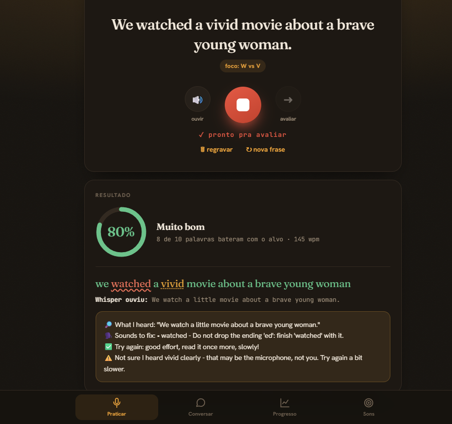
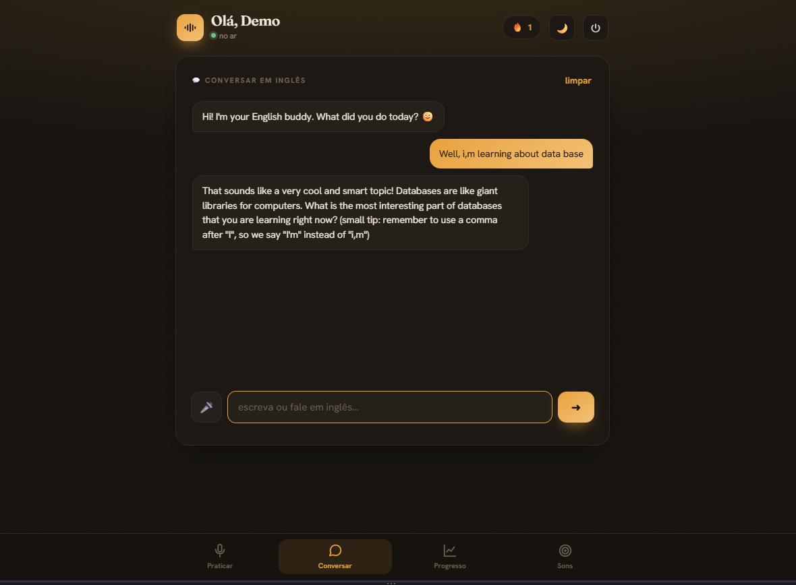
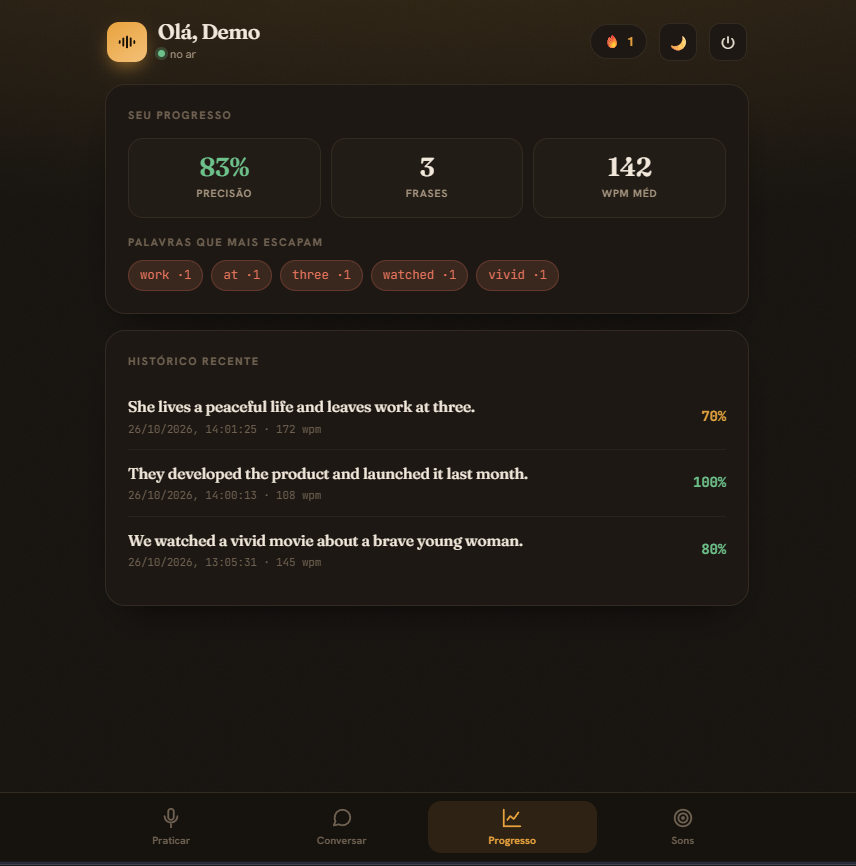
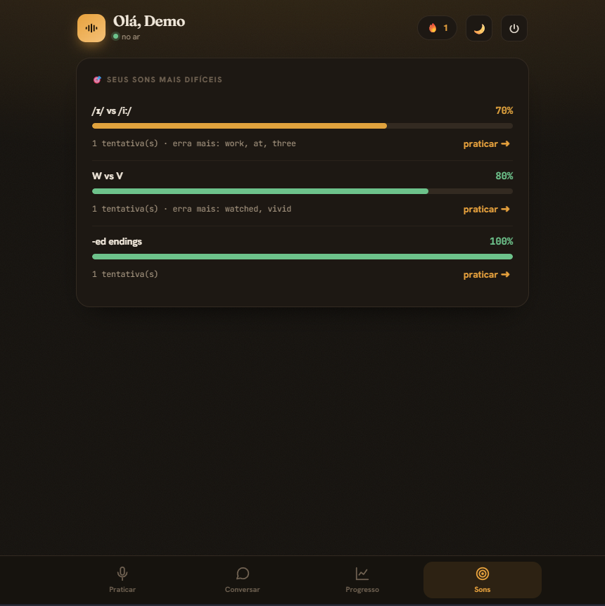

# Pronúncia


App web para treinar pronúncia e conversação em inglês, com Whisper e LLM rodando na própria máquina. O usuário lê frases em voz alta e recebe feedback imediato sobre o que errou, sem pagar API e sem enviar a voz para a nuvem. Foi feito para uso em casa, com 3 usuários.

## Demonstração



| Conversar | Progresso | Sons |
|---|---|---|
|  |  |  |

## Tecnologias Utilizadas

- **Backend:** Python 3.11, FastAPI, Uvicorn, PyJWT, passlib (bcrypt), httpx
- **Banco de dados:** MySQL 8 (PyMySQL)
- **IA local:** whisper.cpp (fala para texto) e LM Studio com Qwen2.5 7B Instruct (feedback e chat)
- **Pronúncia:** CMUdict, pela biblioteca `pronouncing`
- **Áudio:** ffmpeg
- **Frontend:** HTML, CSS e JavaScript puro, instalável como PWA
- **Infraestrutura:** Docker e Docker Compose

## Arquitetura

O navegador grava o áudio e envia para a API FastAPI. O backend converte o áudio com o ffmpeg, transcreve com o whisper.cpp, compara a transcrição com a frase-alvo e pede o feedback ao LLM local. Só o texto e as métricas de cada tentativa vão para o MySQL; o áudio é descartado.

```
navegador ──> FastAPI ──> ffmpeg ──> whisper.cpp ──> diff (alvo × ouvido)
                 │                                         │
                 └──── MySQL (texto e métricas) <──── LLM local (feedback)
```

```
backend/
  app/          rotas, autenticação e serviços (whisper, llm, diff, pronúncia)
  sql/          schema, frases iniciais e migrations
  tests/        avaliação do feedback do LLM
frontend/       interface web (SPA) e PWA
docs/img/       prints usados neste README
docker-compose.yml
```

## Pré-requisitos e Instalação

### Pré-requisitos

- Git
- Docker Desktop (para o caminho com Docker) ou Python 3.11+, MySQL 8 e ffmpeg (para o caminho local)
- [LM Studio](https://lmstudio.ai) com um modelo sem raciocínio, como o Qwen2.5 7B Instruct:
  ```bash
  lms get https://huggingface.co/bartowski/Qwen2.5-7B-Instruct-GGUF -y
  ```
  Em *Developer > Local Server*, clique em **Start** (porta 1234).
- Servidor do [whisper.cpp](https://github.com/ggml-org/whisper.cpp) com um modelo em inglês, como `ggml-medium.en.bin`:
  ```bash
  ./build/bin/whisper-server -m models/ggml-medium.en.bin --host 127.0.0.1 --port 8080
  ```

O Whisper e o LM Studio rodam no seu computador, fora do Docker.

### Passo a passo

1. Clonar o repositório:
   ```bash
   git clone https://github.com/natoawayrj/Ingl-s.git
   cd Ingl-s
   ```
2. Configurar as variáveis de ambiente. Crie o arquivo `backend/env/.env`:
   ```ini
   DB_PASSWORD=escolha_uma_senha
   JWT_SECRET=cole_aqui_uma_chave_aleatoria
   ```
   Para gerar a chave:
   ```bash
   python -c "import secrets; print(secrets.token_hex(32))"
   ```
   Se o Whisper ou o LLM estiverem em outro endereço, ou se você usar uma API compatível com OpenAI, acrescente `WHISPER_URL`, `LLM_URL`, `LLM_MODEL` e `LLM_API_KEY`.
3. Editar nomes, e-mails e senhas dos usuários em `backend/app/seed_users.py`.
4. **Com Docker:** não é preciso criar ambiente virtual nem instalar dependências. Siga para a próxima seção.

   **Sem Docker:** crie o ambiente virtual, instale as dependências e crie o banco:
   ```bash
   cd backend
   python -m venv .venv
   .venv\Scripts\activate          # Windows (Linux/macOS: source .venv/bin/activate)
   pip install -r requirements.txt

   mysql -u root -p < sql/schema.sql
   mysql -u root -p pronuncia < sql/seed_phrases.sql
   ```
   Nesse caminho, o banco é o MySQL local (`DB_HOST` já vem como `127.0.0.1`), com a mesma `DB_PASSWORD` do usuário `root`.

## Como Executar o Projeto

**Com Docker** (a partir da raiz do projeto):

```bash
docker compose --env-file backend/env/.env up -d
docker compose exec backend python -m app.seed_users   # só na primeira vez
```

**Sem Docker** (a partir da pasta `backend`, com o ambiente virtual ativo):

```bash
python -m app.seed_users                               # só na primeira vez
uvicorn app.main:app --port 8000
```

Abra http://127.0.0.1:8000 e entre com um dos usuários criados. A documentação da API fica em http://127.0.0.1:8000/docs.

Para avaliar o feedback do LLM contra os casos de teste (a partir da pasta `backend`):

```bash
python -m tests.run_eval
```

## Funcionalidades

- **Leitura guiada:** frases por nível (A2 a C1) e foco de som; o app transcreve a leitura, compara palavra por palavra e mostra a precisão e as palavras por minuto.
- **Feedback com LLM local:** dicas curtas de pronúncia e, abaixo de 80% de precisão, explicação fonética em português.
- **Conversar:** chat em inglês por texto ou voz, no nível do usuário, com correção leve. A conversa não é salva.
- **Progresso:** precisão média, palavras que mais escapam e histórico das tentativas.
- **Sons:** ranking dos sons mais difíceis, com atalho para praticar o som mais fraco.
- **Painel do responsável:** relatório por usuário e editor de frases.
- **Autenticação:** login com JWT e três usuários.
- **Privacidade:** o áudio nunca é gravado.
- **PWA:** instalável no celular.

## Contribuição

Contribuições são bem-vindas:

1. Abra uma *issue* descrevendo o problema ou a sugestão.
2. Faça um *fork* do repositório e crie uma branch (`git checkout -b minha-melhoria`).
3. Faça as alterações e os commits.
4. Envie a branch e abra um *pull request* explicando o que mudou.

## Autor e Licença

**Autor:** Renato Lázaro Santos Batista · [GitHub](https://github.com/natoawayrj) · [LinkedIn](https://www.linkedin.com/in/renato-santos-dados/)

**Licença:** [MIT](LICENSE)
